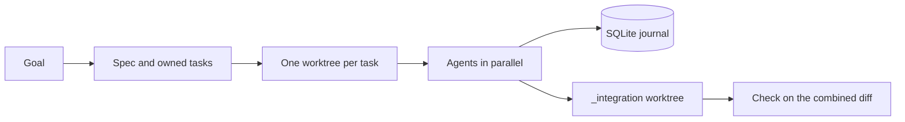

# Vlyn

[](https://github.com/DennisvDijk/Vlyn/actions/workflows/ci.yml)
[](https://github.com/nodejs/release)
[](package.json)

**A coding tool: one goal becomes parallel tasks, each checked, each in its own git worktree.**

The direction is a harness shaped by research on memory and judgment, with an actor whose brain is a journal snapshot and a lightweight sandbox around checks. Actor snapshots are in the journal, repeated failures become lessons the next plan can see, and `vlyn eval` scores scripted verdicts. The sandbox is **planned**. What runs today is the planner, the journal, actor snapshots, lessons, the scripted eval, and verdicts that follow the check.

No runtime dependencies. Node.js and Git.

## 60-second quickstart

```sh
# Node 24.12 or newer. From a clone, `node src/cli.ts` is the same command as `vlyn`.
npm ci --ignore-scripts
npm link

export VLYN_API_KEY=…          # or OPENAI_API_KEY, LITELLM_API_KEY, ANTHROPIC_API_KEY
cd your-project                # a clean Git repository root

vlyn doctor
vlyn auto --goal "Add input validation to the CLI" --check "npm test" --plan-only
vlyn auto --goal "Add input validation to the CLI" --check "npm test"
```

`doctor` checks Node, Git, the endpoint, and whether the tree is clean. `--plan-only` prints the tasks and stops. Without it, each task runs in a detached worktree. Your checkout is not modified.

Repository files the agent reads are sent to the model provider you configured.

Guides: [docs/README.md](docs/README.md).

## How it works



1. The planner returns a short spec and up to eight tasks. Each task names the files it owns. Overlapping or dependent tasks are merged, so what remains can run at once.
2. Each task gets a detached worktree at the same commit. The agent may list, read, replace, and create files, and may run only the check you supplied.
3. Every state change is written to `~/.vlyn` before work continues. `vlyn resume` keeps finished tasks and resets an interrupted one to the base commit.
4. A task is `completed` only when the last check passed after the last edit, inside the owned files. Otherwise it is `unverified` or `failed`.
5. When more than one task completes, Vlyn copies those diffs onto a fresh `_integration` worktree and runs the checks there. Conflicts are reported. Your branch does not move.

## What you can do now

| You want to | Command | Guide |
| --- | --- | --- |
| Install and see a plan | `vlyn doctor`, then `vlyn auto --plan-only` | [Install and first run](docs/how-to/install-and-first-run.md) |
| Point at a model | `VLYN_API_KEY`, `VLYN_BASE_URL`, `vlyn models` | [Connect a model](docs/how-to/connect-a-model.md) |
| Run a goal | `vlyn` or `vlyn auto --goal … --check …` | [Run a goal](docs/how-to/run-a-goal.md) |
| Continue after a crash | `vlyn resume` | [Resume a run](docs/how-to/resume-a-run.md) |
| Read the diff | review prompt: `diff N` | [Review results](docs/how-to/review-results.md) |
| See what a change touches | `vlyn graph`, `vlyn impact` | [Graph and impact in CI](docs/how-to/graph-and-impact-in-ci.md) |
| Check a JSON change against contracts | `vlyn run examples/payments` | [Contract rehearsal](docs/how-to/contract-rehearsal.md) |
| See why the environment is unhappy | `vlyn doctor` | [Troubleshoot](docs/how-to/troubleshoot-with-doctor.md) |

## Research stance

Vlyn is a coding tool. [docs/research/state-of-the-art.md](docs/research/state-of-the-art.md) uses findings on memory, judgment, accidents, and confinement as **analogies** for how a plan is made, how a check is trusted, and how a crash is resumed. It does not claim that Vlyn is a brain, or that a sandbox is present when this OS cannot provide one. The shared phase list is [docs/ROADMAP.md](docs/ROADMAP.md).

## Actors

A task agent can be an actor in the journal: a versioned snapshot of its working context, graph, decisions, claims, hypotheses, and the worktree's commit and diff. Idle actors are not kept in memory. `revert` returns to an earlier snapshot and keeps the later one. `fork` starts a sibling from a snapshot so two hypotheses do not share a brain. A crash retries once from the last snapshot. This is the actor idea, kept local. It does not call [Agent Substrate](https://github.com/agent-substrate/substrate). See [docs/adr/0001-actor-brain-snapshots.md](docs/adr/0001-actor-brain-snapshots.md).

`vlyn actors` lists them. A goal run does not create the rows. Guide: [docs/how-to/actor-snapshots.md](docs/how-to/actor-snapshots.md). The user's checkout is still not where edits land.

## Lessons

Repeated failed or out-of-scope edits become claims in the journal (`unverified`, then `supported` if they happen again). A later clean edit marks a claim `contested`. A retracted claim stays stored and is not put back into the plan. `vlyn lessons` prints a suggestion. It writes `AGENTS.md` only with `--apply`, and only inside a marked section. Stale claims lose weight when the failures that supported them are gone. The weight is an engineering choice, not a fitted forgetting curve. Guide: [docs/how-to/lessons.md](docs/how-to/lessons.md).

## Eval

`vlyn eval` runs a small scripted suite in temporary repositories. It reports how many verdicts matched the case, whether `completed` was used only when the last check passed after the last edit and inside the owned files, and a [Brier score](https://doi.org/10.1175/1520-0493(1950)078%3C0001:VOFEIT%3E2.0.CO;2) of confidences that were recorded before those verdicts. The suite does not call a model. Tokens are a character estimate. Cost is null. The committed numbers are in [docs/evals/baseline.json](docs/evals/baseline.json). They measure the harness, not a live model. Guide: [docs/how-to/eval.md](docs/how-to/eval.md).

## Limitations

These are limits of the code on this branch, not a roadmap in disguise.

- Model access is OpenAI-compatible Chat Completions, plus Anthropic's native API. Gemini and Bedrock need a gateway such as LiteLLM in front.
- Tools are Vlyn's own JSON action protocol. Vendor-native tool calling is not implemented.
- The check command runs as your user. A sandbox that keeps the API key out of that process is planned, not built. Do not point a check at a secret you would not hand a shell script.
- Convergence builds an `_integration` worktree and stops. There is no `vlyn apply`. Copy or cherry-pick the result yourself. Your checkout stays where it was.
- File ownership is whatever the model declared. Overlap is merged. Semantic independence is not proved.
- The import graph is JavaScript and TypeScript relative imports only. Dynamic imports and package imports are invisible. The default text format and `--format json` exit 2 on a cycle. Mermaid and dot exit 0. Treat the graph as a lower bound.
- Memory is recall of earlier task rows plus lesson claims, capped at five items and about 2 KB. `vlyn lessons` prints the suggestion. `--apply` writes only the marked section of `AGENTS.md`.
- `vlyn eval` scores a scripted suite. It does not score a live model.
- Cross-repository reasoning is planned.
- Nothing here has been scored against a live model in CI. Tests use scripted replies.

## Development

```sh
npm ci --ignore-scripts
npm run lint
npm run check
npm test
```

CI lints and typechecks once, then tests on Linux, macOS, and Windows for Node 24 (Maintenance LTS) and Node 26 (Active LTS). See [CONTRIBUTING.md](CONTRIBUTING.md) and [SECURITY.md](SECURITY.md).
