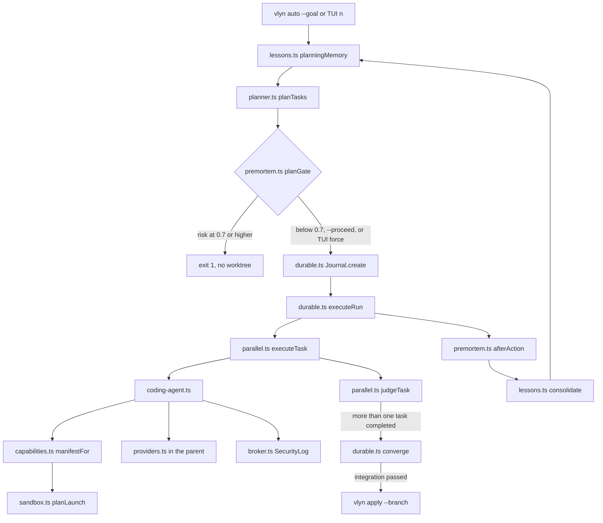
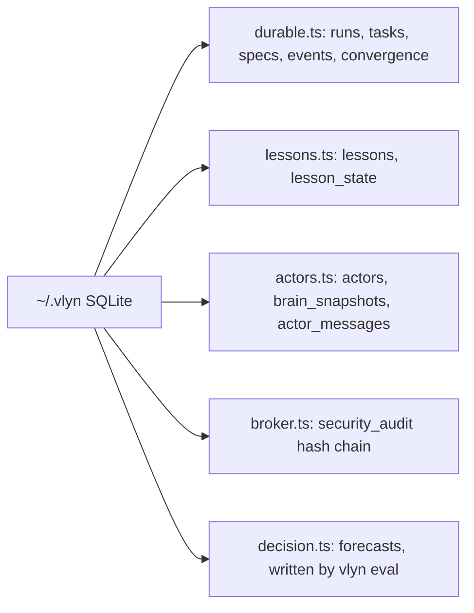
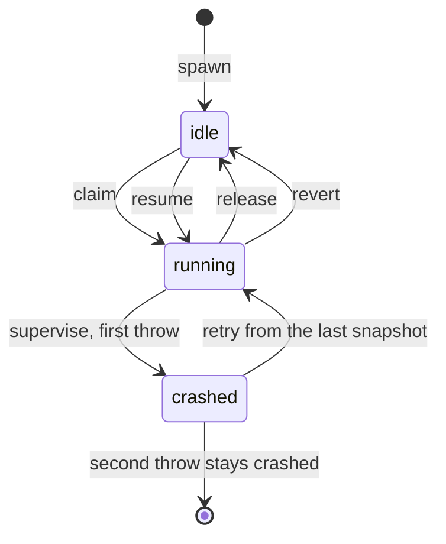
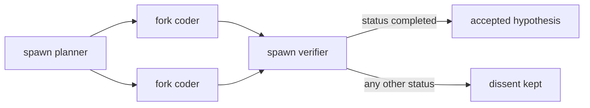

# Vlyn

[](https://github.com/DennisvDijk/Vlyn/actions/workflows/ci.yml)
[](https://github.com/nodejs/release)
[](LICENSE)

**A coding tool: one goal becomes parallel tasks, each checked, each in its own git worktree.**

The direction is a harness shaped by research on memory and judgment, with an actor whose brain is a journal snapshot and a lightweight sandbox around checks. Actor snapshots are in the journal, repeated failures become lessons the next plan can see, and `vlyn eval` scores scripted verdicts. Checks run under the sandbox this operating system can actually enforce. What runs today is the planner, the journal, actor snapshots, lessons, the scripted eval, a pre-mortem gate, apply onto a new branch, and verdicts that follow the check.

No runtime dependencies. Node.js and Git.

## 60-second quickstart

```sh
# Node 24.12 or newer. From a clone, `node src/cli.ts` is the same command as `vlyn`.
npm ci --ignore-scripts
npm link

export VLYN_API_KEY=…          # or OPENAI_API_KEY, LITELLM_API_KEY, ANTHROPIC_API_KEY
cd your-project                # a clean Git repository root

vlyn doctor
vlyn auto --goal "Add input validation to the CLI" --check "npm test" --plan-only
vlyn auto --goal "Add input validation to the CLI" --check "npm test"
```

`doctor` checks Node, Git, the endpoint, and whether the tree is clean. `--plan-only` prints the tasks and stops. Without it, each task runs in a detached worktree. Your checkout is not modified.

Repository files the agent reads are sent to the model provider you configured.

Guides: [docs/README.md](docs/README.md). Where the project is: [docs/STATE.md](docs/STATE.md).

## How a goal run works

`vlyn auto` and the TUI `n` command follow this path. `vlyn auto` does not spawn actor rows. The actor pool is the next diagram.



`planningMemory` puts lesson claims ahead of journal recall, capped at five items and about 2 KB. `planTasks` returns a spec and up to eight tasks, and merges tasks whose owned files overlap. `--plan-only` stops before `preMortem`. A risk at confidence 0.7 or higher returns exit 1 and creates no worktree. `--proceed` and TUI `force` pass the gate.

Each task gets a detached worktree at the same commit. `executeTask` builds a capability manifest when the task has a check or owned files. `coding-agent.ts` may list, read, replace, and create files, and may run only that check. Model calls stay in `providers.ts` in the parent. `SecurityLog` appends allow and deny rows to `security_audit`, each hashed to the previous row. `planLaunch` starts the check with bubblewrap, `unshare`, `sandbox-exec`, or Node `--permission`, whichever this machine actually has. `judgeTask` returns `completed` only when the agent finished, the last check passed after the last edit, and every changed path is inside the owned files. A denied write is `unverified`.

When more than one task is `completed`, `converge` copies those diffs onto `_integration` and runs the checks there. `vlyn apply --branch NAME` commits that tree and creates the branch. It does not move `HEAD`. When the run is finished, `afterAction` stores a short note. The next `vlyn auto` consolidates lessons from those rows before it plans.

The journal is one SQLite file under `~/.vlyn` (`VLYN_HOME` or `--home`).



`brain_snapshots` are versioned JSON. The hash chain is `security_audit`, not the snapshots.

## Actor runtime

`ActorRuntime` in `src/actors.ts` keeps idle actors as rows. A snapshot holds working context, the task graph, episodes, decisions, claims, hypotheses, and a workspace commit and diff. `vlyn actors` lists id, role, state, and version. Roles are `planner`, `coder`, `reviewer`, `verifier`, and `supervisor`. A goal run does not call this. Guide: [docs/how-to/actor-snapshots.md](docs/how-to/actor-snapshots.md).



`checkpoint` writes the next `brain_snapshots` version and drops the in-memory brain. Sleep on that checkpoint runs `consolidateBrain`. `resume` with an outcome runs `reconsolidate` and writes another version. `revert` points `current_version` at an older snapshot and leaves later versions in the table. `fork` inserts a new idle actor. It does not change the parent.

`raceHypotheses` in `src/actor-coding.ts` is the concrete fork path. It is not a CLI command. It spawns a planner, forks one coder per hypothesis, runs `executeTask` in that coder's worktree, and lets a verifier accept only status `completed`. The other ids stay as dissent. Siblings do not see each other's diffs.



`supervise` is the one-for-one supervisor: one retry from the last snapshot, then `crashed`.

## What you can try

| Coding benefit | Command | Guide |
| --- | --- | --- |
| See the plan before any edit | `vlyn auto --goal "…" --check "npm test" --plan-only` | [Run a goal](docs/how-to/run-a-goal.md) |
| Stop a plan that already looks failed | `vlyn auto --goal "…" --check "npm test"` | [Pre-mortem and apply](docs/how-to/premortem-and-apply.md) |
| Continue after Ctrl+C without redoing finished tasks | `vlyn resume` | [Resume a run](docs/how-to/resume-a-run.md) |
| Read a task diff. Your checkout stays put | review prompt `diff N` | [Review results](docs/how-to/review-results.md) |
| Put the combined result on a new branch without moving HEAD | `vlyn converge`, then `vlyn apply --branch NAME` | [Pre-mortem and apply](docs/how-to/premortem-and-apply.md) |
| Show the next plan a failure it has already seen | `vlyn lessons` | [Lessons](docs/how-to/lessons.md) |
| Write that suggestion into the marked section of AGENTS.md | `vlyn lessons --apply` | [Lessons](docs/how-to/lessons.md) |
| List idle actors and their snapshot version | `vlyn actors` | [Actor snapshots](docs/how-to/actor-snapshots.md) |
| Score verdict honesty and calibration without a model | `vlyn eval` | [Eval](docs/how-to/eval.md) |
| See which confinement this OS actually has | `vlyn doctor` | [Sandbox and audit](docs/how-to/sandbox-and-audit.md) |
| Refuse a check this OS cannot confine | `vlyn auto --require-sandbox` | [Sandbox and audit](docs/how-to/sandbox-and-audit.md) |
| Read the hash-chained allow and deny log | `vlyn audit` | [Sandbox and audit](docs/how-to/sandbox-and-audit.md) |
| Point at an OpenAI-compatible gateway, Anthropic, or Ollama | `vlyn models` | [Connect a model](docs/how-to/connect-a-model.md) |
| Fail CI on a JavaScript or TypeScript import cycle | `vlyn graph .` | [Graph and impact](docs/how-to/graph-and-impact-in-ci.md) |
| Catch a JSON break against a recorded consumer | `vlyn run examples/payments` | [Contract rehearsal](docs/how-to/contract-rehearsal.md) |
| Test Node 24 and 26 on Linux, macOS, and Windows, and audit the lockfile | GitHub Actions job `CI result` | [Contributing](docs/how-to/contributing.md) |

## Research stance

Vlyn is a coding tool. [docs/research/state-of-the-art.md](docs/research/state-of-the-art.md) uses findings on memory, judgment, accidents, and confinement as **analogies** for how a plan is made, how a check is trusted, and how a crash is resumed. It does not claim that Vlyn is a brain, or that a sandbox is present when this OS cannot provide one. The shared phase list is [docs/ROADMAP.md](docs/ROADMAP.md).

## Actors

A task agent can be an actor in the journal: a versioned snapshot of its working context, graph, decisions, claims, hypotheses, and the worktree's commit and diff. Idle actors are not kept in memory. `revert` returns to an earlier snapshot and keeps the later one. `fork` starts a sibling from a snapshot so two hypotheses do not share a brain. A crash retries once from the last snapshot. This is the actor idea, kept local. It does not call [Agent Substrate](https://github.com/agent-substrate/substrate). See [docs/adr/0001-actor-brain-snapshots.md](docs/adr/0001-actor-brain-snapshots.md).

`vlyn actors` lists them. A goal run does not create the rows. Guide: [docs/how-to/actor-snapshots.md](docs/how-to/actor-snapshots.md). The user's checkout is still not where edits land.

## Lessons

Repeated failed or out-of-scope edits become claims in the journal (`unverified`, then `supported` if they happen again). A later clean edit marks a claim `contested`. A retracted claim stays stored and is not put back into the plan. `vlyn lessons` prints a suggestion. It writes `AGENTS.md` only with `--apply`, and only inside a marked section. Stale claims lose weight when the failures that supported them are gone. The weight is an engineering choice, not a fitted forgetting curve. Guide: [docs/how-to/lessons.md](docs/how-to/lessons.md).

## Eval

`vlyn eval` runs a small scripted suite in temporary repositories. It reports how many verdicts matched the case, whether `completed` was used only when the last check passed after the last edit and inside the owned files, and a [Brier score](https://doi.org/10.1175/1520-0493(1950)078%3C0001:VOFEIT%3E2.0.CO;2) of confidences that were recorded before those verdicts. The suite does not call a model. Tokens are a character estimate. Cost is null. The committed numbers are in [docs/evals/baseline.json](docs/evals/baseline.json). They measure the harness, not a live model. Guide: [docs/how-to/eval.md](docs/how-to/eval.md).

## Before and after a run

`auto` asks a second, independent pass how the plan fails before it edits. A risk at confidence 0.7 or higher stops the run. `--proceed` continues anyway. The interactive session does the same on `go`; `force` is the override. When the run finishes, the journal stores a short after-action note from the task statuses and the integration result.

`vlyn converge [id]` rebuilds the `_integration` worktree and re-runs the checks. `vlyn apply [id] --branch NAME` commits that result and creates the branch. It does not check out the branch and it does not change the files in your working tree. Guide: [docs/how-to/premortem-and-apply.md](docs/how-to/premortem-and-apply.md).

## Security

Checks run with a capability manifest: the task's files, the exact check string, and no child network unless this machine cannot actually enforce that. The API key stays in the parent process. Check environments drop variables whose names look like secrets, and those values are redacted out of tool output and the audit log.

`vlyn doctor` prints which confinement is real on this OS (`unshare`, bubblewrap, `sandbox-exec`, Node's `--permission`, or only the in-process gate). Landlock and seccomp are not on. Node's permission model is a seatbelt for trusted code, and on Node 24 it did not stop outbound TCP; the doctor line says when the network is actually cut. `--require-sandbox` refuses a check we cannot confine. `vlyn audit [run]` prints the hash-chained log and exits 2 if a row was edited. Guide: [docs/how-to/sandbox-and-audit.md](docs/how-to/sandbox-and-audit.md).

One local sample of a no-op check was 24 ms sandboxed against 21 ms plain (`docs/security/overhead.json`). That is one machine, not a promise. The threat model is [docs/security/threat-model.md](docs/security/threat-model.md). The decision is [docs/adr/0002-capability-sandbox.md](docs/adr/0002-capability-sandbox.md).

## Limitations

These are limits of the code on this branch, not a roadmap in disguise.

- Model access is OpenAI-compatible Chat Completions, plus Anthropic's native API. Gemini and Bedrock need a gateway such as LiteLLM in front.
- Coding turns ask OpenAI-compatible and Anthropic endpoints for native tools. A text JSON action is the fallback when the model or gateway does not. Gemini and Bedrock still need a gateway. Guide: [docs/how-to/native-tools.md](docs/how-to/native-tools.md).
- A check is network-confined only when `unshare`, bubblewrap, or `sandbox-exec` is what launches it. Node's `--permission` flag limits file reads for `node` checks and, on Node 24.12, did not block `net.connect`. Landlock and seccomp are not used. `--require-sandbox` refuses that weaker case. `vlyn batch` does not pass the flag through.
- `vlyn apply --branch NAME` creates a new branch from the integration commit. It does not check out that branch and it does not change the files in your working tree. Integration has to pass first.
- File ownership is whatever the model declared. Overlap is merged. Semantic independence is not proved.
- The import graph is JavaScript and TypeScript relative imports only. Dynamic imports and package imports are invisible. The default text format and `--format json` exit 2 on a cycle. Mermaid and dot exit 0. Treat the graph as a lower bound.
- Memory is recall of earlier task rows plus lesson claims, capped at five items and about 2 KB. `vlyn lessons` prints the suggestion. `--apply` writes only the marked section of `AGENTS.md`.
- `vlyn eval` scores a scripted suite. It does not score a live model.
- Cross-repository reasoning is planned.
- Nothing here has been scored against a live model in CI. Tests use scripted replies.

## License

Vlyn is licensed under the Apache License, Version 2.0. Copyright 2026 Dennis van Dijk. The terms are in [LICENSE](LICENSE). Attribution is in [NOTICE](NOTICE).

## Development

```sh
npm ci --ignore-scripts
npm run lint
npm run check
npm test
```

CI lints and typechecks once, then tests on Linux, macOS, and Windows for Node 24 (Maintenance LTS) and Node 26 (Active LTS). See [CONTRIBUTING.md](CONTRIBUTING.md) and [SECURITY.md](SECURITY.md).
