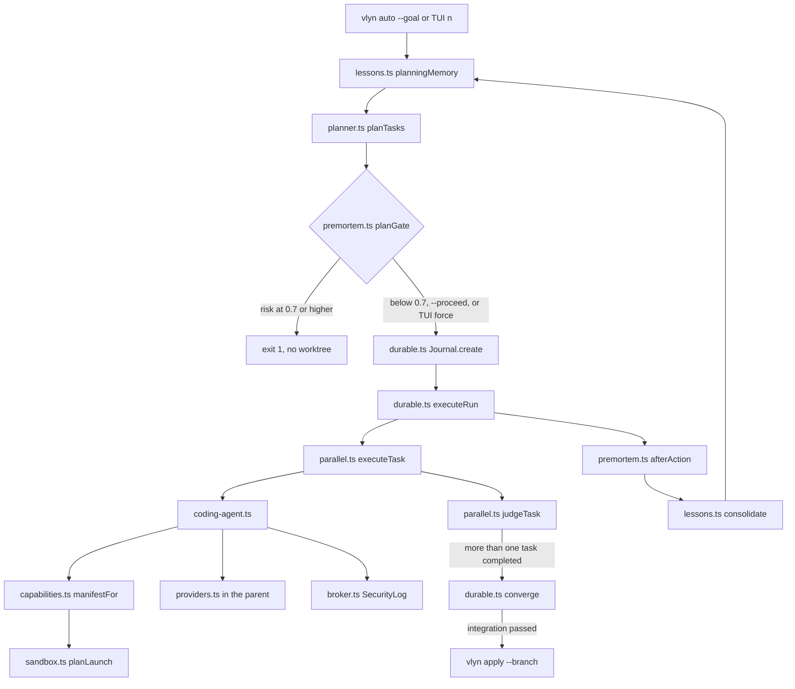
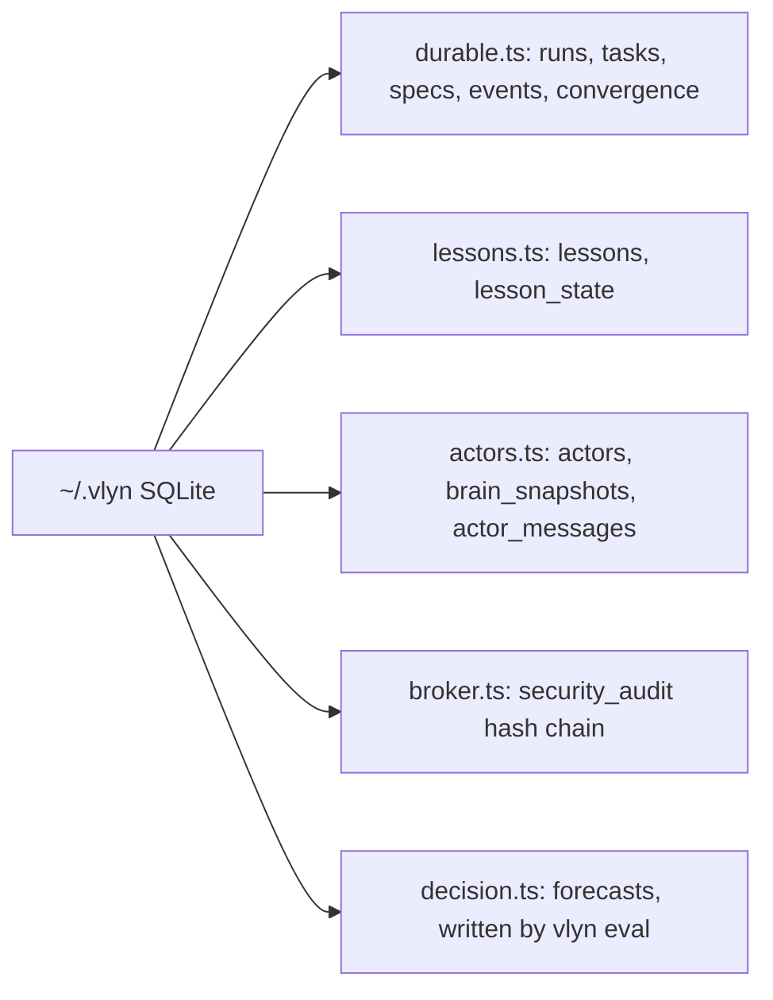

# Frozen modules

Vlyn is a measurement instrument for trust in coding agents ([README](../README.md), [ADR 0003](adr/0003-measurement-first.md)). It started as a coding agent harness. That part is frozen.

"Frozen" does not mean deleted. Nothing was removed or moved. It means:

- no new features and no maintenance in `main` until an eval gives a reason;
- the code and its tests stay, and the tests stay green;
- the CLI commands keep working and are marked `(frozen)` in `vlyn --help`.

Why: agent loops, toolsets and planners are done better by Claude Code, Codex, Pi and OpenCode, and parallel worktrees by herdr, worktrunk and cmux. Vlyn's open question is narrower: a confidence number you can prove is right. Everything that does not serve that is frozen until the measurement says otherwise.

| Module | What happens | Why |
| --- | --- | --- |
| `sandbox.ts`, `capabilities.ts` | Reuse for the check and the accept run. Later extend to the agent process | The check must run isolated, with a scrubbed env |
| `broker.ts` (`SecurityLog`) | Reuse. `predictions` and `outcomes` go into the chain too | Proves the prediction came before the outcome |
| `durable.ts` (`Journal`), `decision.ts` | Reuse and extend with the new tables | Same SQLite under `~/.vlyn` |
| `parallel.ts` (`judgeTask`, `owns`, diff collection) | Reuse. `judgeTask` gains `protected`, `skipMarkers` and `conflict` | The verdict from facts in the worktree is the strongest part |
| `lessons.ts` | Reuse. Lessons go to the external agent via `AGENTS.md` or the prompt | Lessons are part of the learning loop later |
| `durable.ts` (`converge`, `applyToBranch`) | Reuse for `vlyn apply` | Applying to a branch without touching the checkout |
| `coding-agent.ts`, `llm/*`, `providers.ts` | **Frozen.** `providers.ts` stays only for the `selfConfidence` question | Vlyn does not run its own agent loop |
| `planner.ts`, `premortem.ts` | **Frozen** until a `--batch` mode exists | One task per `judge` |
| `actors.ts`, `actor-coding.ts` | **Frozen** | Not on the path of the verdict |
| `state.ts`, `examples/payments` | **Frozen**, or a separate repository | Demo, not instrument |
| `graph.ts`, `tools.ts` (`vlyn graph`, `impact`) | Stays as a standalone tool and supplies `tests_to_run` as a signal | Cerebellum-style forward model signal |

Frozen CLI commands: `tui`, `auto`, `resume`, `runs`, `actors`, `code`, `batch`, `plan`, `run`, `status`. The commands `lessons`, `eval`, `converge`, `apply`, `audit`, `models`, `graph`, `impact` and `doctor` are not frozen.

Unfreezing a module needs an eval result that justifies it, recorded in [STATE.md](STATE.md).

## How a frozen goal run works

`vlyn auto` and the TUI `n` command follow this path. `vlyn auto` does not spawn actor rows.

Each task gets a detached worktree at the same commit. `judgeTask` returns `completed` only when the agent finished, the last check passed after the last edit, and every changed path is inside the owned files. When more than one task is `completed`, `converge` copies those diffs onto `_integration` and runs the checks there. `vlyn apply --branch NAME` commits that tree and creates the branch without moving `HEAD`. The journal is one SQLite file under `~/.vlyn` (`VLYN_HOME` or `--home`).

`ActorRuntime` in `src/actors.ts` keeps idle actors as versioned snapshots (spawn, claim, release, revert, fork, supervise). A goal run does not call it. Guide: [docs/how-to/actor-snapshots.md](docs/how-to/actor-snapshots.md).
